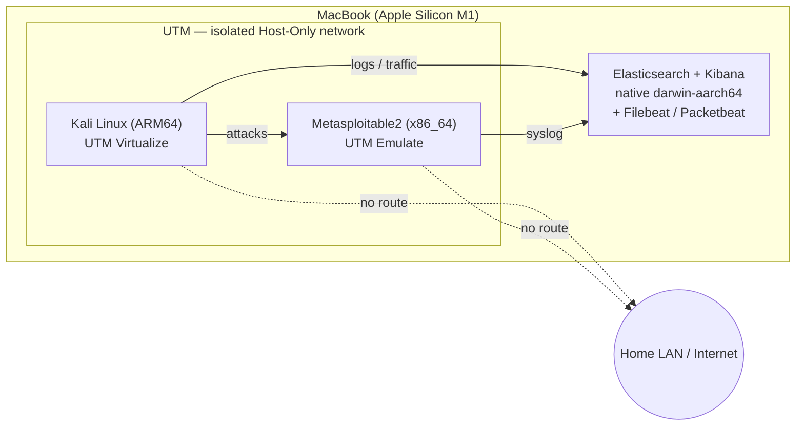

# Virtualized Security Lab

Fall 2026 DIS (LIS4905) — an isolated lab with a target to attack, Kali Linux
to attack from, and an Elastic/Kibana SIEM to monitor and detect the attacks,
built on an Apple Silicon Mac.

## Overview
[1–2 sentence summary — fill in once the lab is built]

## Lab Architecture
- **Attacker:** Kali Linux (ARM64) — UTM, Virtualize mode
- **Target:** Metasploitable2 (x86_64) — UTM, Emulate mode
- **Monitoring (SIEM):** Elasticsearch + Kibana — run natively on the host Mac
  from Elastic's official `darwin-aarch64` archives (no Docker, no x86
  emulation). Filebeat + Packetbeat feed logs and host-only network traffic in.
- **Network:** UTM **Host Only** network for Kali + Metasploitable2 (isolated
  from the real LAN/internet; the host Mac can reach both). The VMs send logs to
  the Mac at the host-only gateway address; Elastic/Kibana bind only to
  localhost + that gateway, never to the LAN.

> **Why not Splunk / VirtualBox (original proposal plan):** this machine is an
> Apple Silicon M1 on macOS 12. VirtualBox can't run x86 guests here, and Splunk
> Enterprise has no ARM64 build — the Docker/Colima x86-emulation path for
> Splunk repeatedly failed on this OS. The proposal allows "a tool *like*
> Splunk," so the SIEM is Elastic/Kibana, run natively on ARM. See Build Notes.

## Build Notes
Decisions and actual values recorded as the lab is built.

- **Host:** Apple M1, 8 GB RAM, macOS 12.3 (Monterey), ~34 GB free disk.
- **UTM:** 4.7.5. CLI control via `/Applications/UTM.app/Contents/MacOS/utmctl`
  (not on PATH). Kali VM UUID `66689B96-B3D4-4698-990A-93712C0E82D0`.
- **Host-only subnet / IPs:** [fill in after first host-only boot — run
  `ifconfig` for the `vmenet`/`bridge` UTM creates; record gateway + each VM IP]
- [Add setup steps and decisions here as the lab is built.]

## Attack Log
See `Attack_Log_Template.md` — entries added chronologically as attacks are
run.

## Detections
[Kibana searches/dashboards built for each attack, with screenshots]

## Report
See `Report_Outline.md` for the report skeleton; final report linked here
once written.
