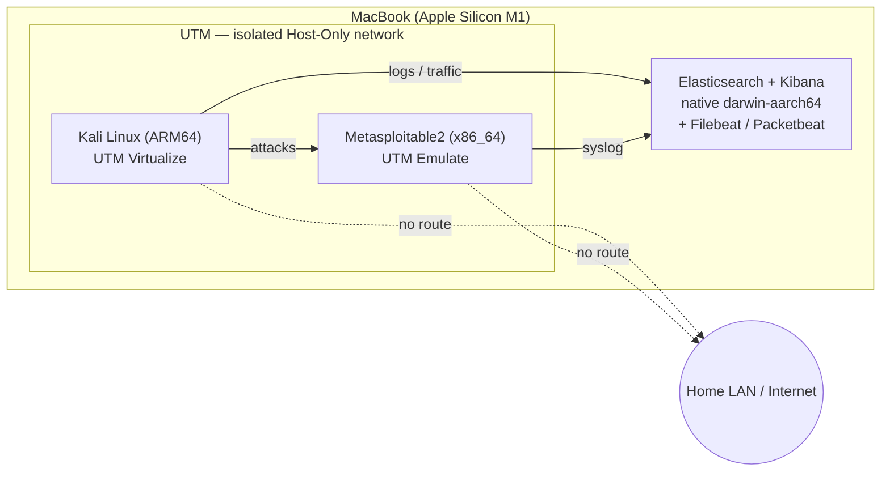

# Virtualized Security Lab

Fall 2026 DIS (LIS4905) — an isolated lab with a target to attack, Kali Linux
to attack from, and an Elastic/Kibana SIEM to monitor and detect the attacks,
built on an Apple Silicon Mac.

## Overview
[1–2 sentence summary — fill in once the lab is built]

## Lab Architecture
- **Attacker:** Kali Linux (ARM64) — UTM, Virtualize mode
- **Target:** Metasploitable2 (x86_64) — UTM, Emulate mode
- **Monitoring (SIEM):** Elasticsearch + Kibana — run natively on the host Mac
  from Elastic's official `darwin-aarch64` archives (no Docker, no x86
  emulation). Filebeat + Packetbeat feed logs and host-only network traffic in.
- **Network:** UTM **Host Only** network for Kali + Metasploitable2 (isolated
  from the real LAN/internet; the host Mac can reach both). The VMs send logs to
  the Mac at the host-only gateway address; Elastic/Kibana bind only to
  localhost + that gateway, never to the LAN.

> **Why not Splunk / VirtualBox (original proposal plan):** this machine is an
> Apple Silicon M1 on macOS 12. VirtualBox can't run x86 guests here, and Splunk
> Enterprise has no ARM64 build — the Docker/Colima x86-emulation path for
> Splunk repeatedly failed on this OS. The proposal allows "a tool *like*
> Splunk," so the SIEM is Elastic/Kibana, run natively on ARM. See Build Notes.

## Build Notes
Decisions and actual values recorded as the lab is built.

- **Host:** Apple M1, 8 GB RAM, macOS 12.3 (Monterey), ~34 GB free disk.
- **UTM:** 4.7.5. CLI control via `/Applications/UTM.app/Contents/MacOS/utmctl`
  (not on PATH). Kali VM UUID `66689B96-B3D4-4698-990A-93712C0E82D0`.

### Kali VM build (2026-11-08)
- **Network:** set to UTM **Host Only** (`Mode=Host`, isolate-from-host off).
  DHCP *is* served on the host-only subnet, but the installer reported **no
  default route** — i.e. the VM gets a local IP yet has **no path to the
  internet**. That is the isolation we want; chose "continue without a default
  route" and installed from the ISO offline.
- **Installer media gotcha:** UTM imported the Kali ISO as a **Disk** (qcow2),
  not a CD, and defaulted its interface to **USB**. Booting off emulated USB was
  so slow it looked hung. **Fix: set the installer drive's interface to VirtIO**
  (UTM Edit → the drive → VirtIO). Boots fast after that.
- **Display gotcha (important):** this VM's **graphical console never renders
  the Linux kernel / installer** — GRUB's menu shows, then the screen goes blank
  ("display output is not active") on both `virtio-gpu-pci` and `virtio-ramfb`.
  `nomodeset` makes it worse (arm64 has no VGA text fallback). **Workaround: a
  serial console.** Added a UTM **TCP-Server serial** (port 4321), booted the
  text installer with kernel args `console=ttyAMA0,115200 DEBIAN_FRONTEND=text`,
  and drove the whole install over `nc 127.0.0.1 4321`. Kali runs headless;
  operate it via serial / SSH over the host-only net.
- **Credentials:** user `kali` / password `kali` (lab-only, isolated host).
- **The installed system boots over serial too** — removing the installer disk
  (so UEFI boots the real disk) revealed the installer had already propagated the
  serial console: `kali login:` appears on `ttyAMA0` (TCP port 4321). Kernel
  6.19 arm64.
- **Access:** SSH enabled on Kali (`sudo systemctl enable --now ssh`); key-based
  login from the Mac via `ssh -i ~/.ssh/kali_lab kali@192.168.128.2`. Serial on
  port 4321 kept as console fallback.

### Host-only network (verified 2026-11-08)
| Node | Interface | IP |
|---|---|---|
| Host Mac (gateway) | `bridge100` | `192.168.128.1` |
| Kali (attacker) | `eth0` | `192.168.128.2` |
| Metasploitable2 (target) | tbd | `192.168.128.x` (pending) |

Subnet `192.168.128.0/24`. DHCP is served on it, but there is **no default
route** — verified from Kali that `curl https://example.com` fails
(NO_INTERNET), so the lab cannot reach the real LAN or the internet. Elastic/
Kibana will bind to `192.168.128.1` + localhost only.

**Installed Kali tools confirmed:** nmap, metasploit-framework (msfconsole),
hydra, sqlmap, nikto.

## Attack Log
See `Attack_Log_Template.md` — entries added chronologically as attacks are
run.

## Detections
[Kibana searches/dashboards built for each attack, with screenshots]

## Report
See `Report_Outline.md` for the report skeleton; final report linked here
once written.
