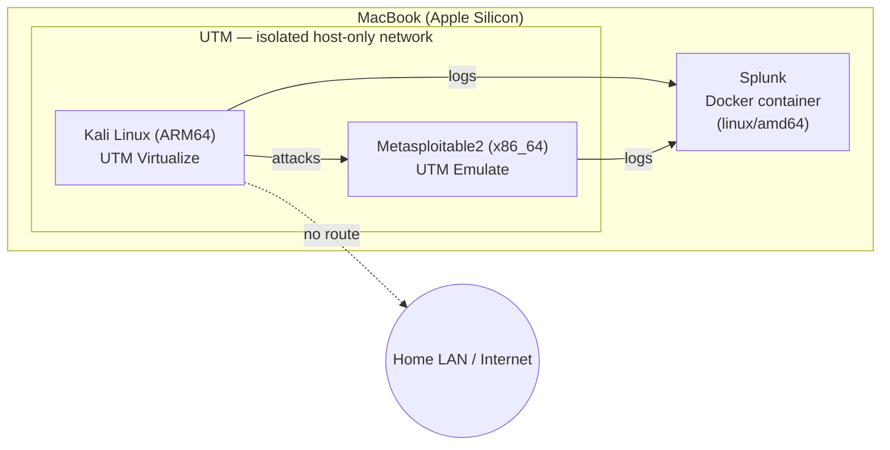

# Virtualized Security Lab

Fall 2026 DIS (LIS4905) — a target to attack, Kali Linux to attack from, and
Splunk to monitor and detect the attacks, built on an Apple Silicon Mac.

## Overview
[1–2 sentence summary — fill in once the lab is built]

## Lab Architecture
- **Attacker:** Kali Linux (ARM64) — UTM, Virtualize mode
- **Target:** Metasploitable2 (x86_64) — UTM, Emulate mode
- **Monitoring:** Splunk — Docker container (`splunk/splunk`, `--platform linux/amd64`) on the host Mac
- **Network:** UTM Host-only network for Kali + Metasploitable2 (isolated from the real LAN/internet; host Mac can reach both). Splunk's container ports are published on the host and reached via the host's IP on that same subnet.

> Built on Apple Silicon: VirtualBox can't run x86 guests here, and Splunk
> Enterprise has no ARM64 build — see Build Notes for why UTM + Docker was
> chosen over the original VirtualBox plan.

## Build Notes
[Setup steps and decisions, added as the lab is built. Record actual UTM
host-only subnet/IPs here once assigned.]

## Attack Log
See `Attack Log Template.md` — entries added chronologically as attacks are
run, starting Week 4.

## Detections
[Splunk searches/dashboards built for each attack, with screenshots]

## Report
See `Report Outline.md` for the report skeleton; final report linked here
once written.
